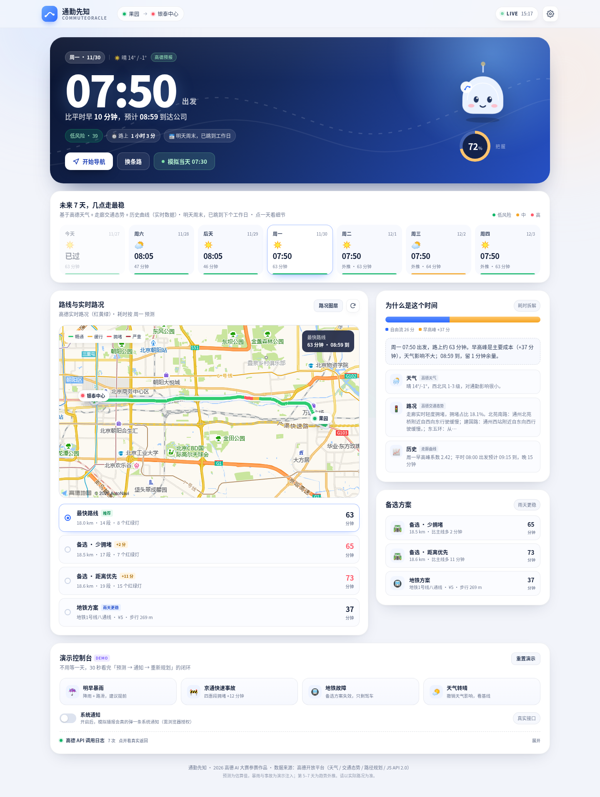

# 通勤先知 · CommuteOracle

> **明早几点走，今晚就知道；路上有变，提前叫你。**
>
> 2026 高德 AI 大赛「形式 B：使用高德 AI 能力的应用」参赛作品

[在线 Demo](https://jiwangreal.github.io/commute-oracle/) ·
[作品方案文档](doc/plan.html) ·
[演示脚本](doc/DEMO_SCRIPT.md) ·
[合规声明](doc/COMPLIANCE.md)



---

## 它解决什么问题

早高峰通勤的决策发生在**出门之前**，但所有地图产品都默认「上车再查」。等看到一片红，能做的只剩换一条同样堵的路。

通勤先知把决策提前到**前一晚**和**当天早上 07:30**，直接给结论：

> 「周一建议 **07:35** 出发，比平时早 25 分钟。京通快速四惠段有事故、昌平暴雨，预计 **09:00** 到，把握 **87%**。」

用户拿到的是 **几点走 + 走哪条 + 为什么 + 多大把握**，而不是一堆需要自己心算的原始数据。

## 30 秒体验

1. 打开页面，首屏就是「下一次通勤」的结论（周末会自动跳到下个工作日）。
2. 点「为什么是这个时间」：耗时被拆成自由流 / 早高峰 / 天气 / 突发四段，每条都标了数据来源。
3. 点「未来 7 天」任意一天，切换查看那天的推荐出发时间与风险。
4. 打开底部「演示控制台」，点 **明早暴雨** 或 **京通快速事故**：推荐时间立刻变化，右上角弹出播报。
5. 点「模拟明早 07:30」：时间旅行到当天早晨，体验打开地图就收到通知的那一刻。
6. 点「开始导航」：通过高德 URI API 唤起导航。

页面底部可展开**高德 API 调用日志**，每一次天气、路况、路径规划请求都能看到耗时和原始返回。

## 功能

- **7 天出发时间预测**：基于真实天气、走廊实时路况、历史早高峰曲线，给出每天的最晚可行出发时刻。
- **可解释**：耗时分段堆叠 + 三条证据（天气 / 路况 / 历史），并给出置信度。
- **恶劣天气 / 突发路况**：暴雨、事故、地铁故障可注入，推荐时间与路线实时重排。
- **主动播报**：站内手机锁屏式通知 + 浏览器系统通知（Notification API）。
- **路线地图**：高德 JS API 2.0 底图、TMC 红黄绿路段、主/备路线、事故标记、可切换实时路况图层。
- **一键导航**：高德 URI API 直接唤起。
- **降级可用**：接口异常时自动切到构建期快照，页面功能不缺失。

## 高德开放平台能力

| 能力 | 接口 / 组件 | 用途 |
| --- | --- | --- |
| 地理编码 | `/v3/geocode/geo` | 家 / 公司地址 → 坐标 |
| 天气实况 + 预报 | `/v3/weather/weatherInfo` | 当前天气与未来 4 天预报 |
| 交通态势 | `/v3/traffic/status/circle` | 家 / 走廊 / 公司三点采样，校准实时拥堵 |
| 驾车路径规划 v5 | `/v5/direction/driving` | 主路线 + 2 条备选，含 `cost`、`tmcs`、`polyline` |
| 公交路径规划 v5 | `/v5/direction/transit/integrated` | 雨天 / 拥堵时的地铁方案 |
| JS API 2.0 | `AMap.Map` / `TileLayer.Traffic` / `Polyline` / `Marker` | 地图、路况图层、路线与标记 |
| URI API | `uri.amap.com/navigation` | 一键唤起高德导航 |
| amap-gui CLI / Skill | `route` / `mapState` / `searchPOI` | Agent 侧路线预演与地图操控 |

## 预测模型

```
T_pred(d,t) = T_free × scale × K_time(weekday,t) × K_weather(d) × liveAdj + ΔI(d,t)
```

- `T_free`：自由流耗时（距离 ÷ 45 km/h）
- `scale`：用当前高德实测耗时校准自由流与历史曲线，避免模型与实测脱节
- `K_time`：走廊早高峰曲线（星期 × 10 分钟，0.95–2.95）
- `K_weather`：晴 1.00 / 小雨 1.12 / 中雨 1.22 / 大雨 1.35 / 暴雨 1.50 / 雪 1.45 / 雾 1.30
- `liveAdj`：交通态势拥堵占比的实时校准（0.94–1.06）
- `ΔI`：事故 / 地铁故障的额外耗时，随时间消散

在候选出发时刻中，选择「到达 ≤ 期望到达」的**最晚**可行时刻；若全部不可行，则给出最早可行方案与预计迟到分钟数。详细说明见 [作品方案文档](doc/plan.html#s2-5)。

## 本地运行

纯静态站点，无构建步骤：

```bash
git clone https://github.com/Jiwangreal/commute-oracle.git
cd commute-oracle
python3 -m http.server 8080
# 打开 http://localhost:8080
```

> 也可以直接双击 `index.html`。首次加载会请求高德接口；若网络受限，会自动使用 `assets/js/snapshot.js` 中的构建期快照。

### 重新生成数据快照

```bash
node scripts/snapshot.mjs
# 写入 assets/js/snapshot.js 与 data/fallback-snapshot.json
```

### Agent 侧巡航（可选）

```bash
node scripts/agent-morning.mjs
```

脚本会优先调用 `amap-gui`（需要图形环境）做路线预演与地图视角设置；不可用时自动回落到高德 Web 服务 API，并输出一份晨间简报。

## 目录

```
.
├── index.html                  # 单页 Demo
├── assets/
│   ├── css/app.css             # 视觉系统
│   └── js/
│       ├── config.js           # 示例通勤、模型参数、接口地址
│       ├── snapshot.js         # 构建期快照（降级用）
│       ├── util.js             # 工具
│       ├── predict.js          # 可解释预测模型
│       ├── data.js             # 高德数据层
│       ├── map.js              # JS API 2.0 地图封装
│       └── app.js              # 渲染与交互
├── data/fallback-snapshot.json # 高德原始返回留档
├── doc/
│   ├── PLAN.md                 # 方案文档（Markdown）
│   ├── plan.html               # 方案文档（可打印 Q 版）
│   ├── DEMO_SCRIPT.md          # 5 分钟录屏脚本
│   ├── COMPLIANCE.md           # 合规性声明模板
│   └── screenshots/            # 演示截图
├── scripts/
│   ├── snapshot.mjs            # 生成快照
│   └── agent-morning.mjs       # amap-gui / REST 巡航
└── README.md
```

## 已知边界

- 预报只有 4 天，第 5–7 天为趋势外推，UI 明确标注「外推」，置信度相应降低。
- 未来时刻的路况由「历史曲线 × 实时校准」估算，不宣称能预知事故。
- 演示中的暴雨、事故、地铁故障均为**注入情景**，用于展示系统反应，会明确标注「演示注入」。
- 示例 Key 仅用于赛事演示；正式部署前请在高德控制台配置域名白名单并替换为自己的 Key。

## 数据与隐私

- 家 / 公司地址只保存在浏览器 `localStorage`，不上传。
- 所有地图与交通数据来自高德开放平台，遵守其服务条款。
- 预测结果为估算值，请以实际路况为准。

## License

[MIT](LICENSE)
